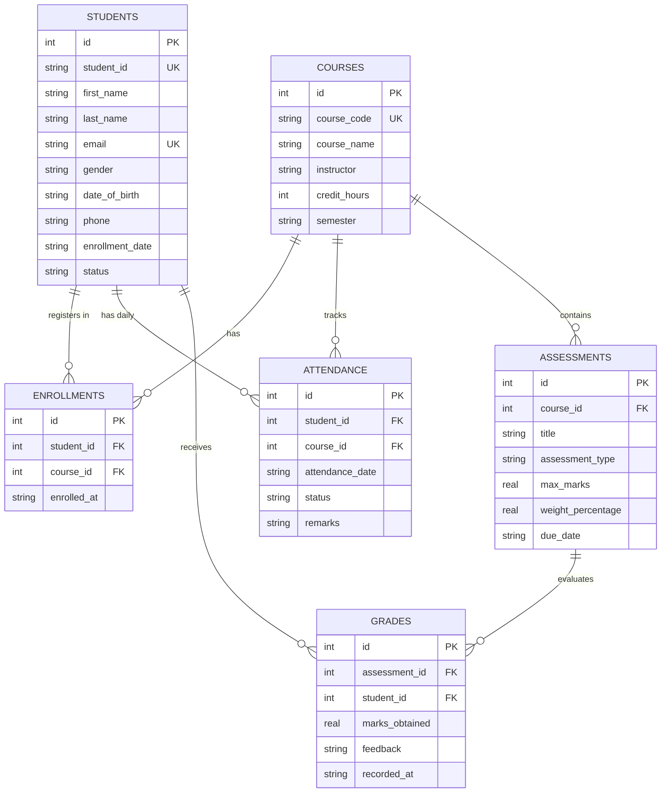

#  Classroom Management System (CMS)

A production-grade **Classroom Management System** built with **Python 3** and **SQL (SQLite)** to track, manage, and analyze **student attendance** and **academic performance** (assessments, grades, weighted scoring, GPA, and transcripts).

Includes both a **modern graphical user interface (Tkinter GUI)** with real-time KPI dashboards and an **interactive terminal menu (CLI)** for headless or power-user workflows.

---

##  Key Features

### 1.  Student & Curriculum Management
- Full CRUD operations for student profiles: Student ID, Full Name, Email, Gender, Date of Birth, Phone, Enrollment Date, and Status (`Active`, `Inactive`, `Graduated`, `Suspended`).
- Course catalog with Course Code, Course Title, Instructor, Credit Hours, and Semester.
- Student enrollment and course roster management.
- Real-time search and filter across name, ID, or email.

### 2. Attendance Tracker
- Track attendance by course session: `Present`, `Absent`, `Late`, `Excused`, with optional notes/remarks.
- Bulk roll call marking: Quickly mark an entire class session, or use the **"Mark All Present"** shortcut.
- Visual status indicators and double-click inline toggle on the attendance sheet.
- Live attendance calculation formula:
  $$\text{Attendance Rate} = \frac{\text{Present} + (0.75 \times \text{Late})}{\text{Total Sessions}} \times 100\%$$
- **Automatic Attendance Alerts**: Flags students whose attendance drops below **75%**.

### 3.  Academic Evaluations & Gradebook
- Flexible assessment types: `Quiz`, `Assignment`, `Midterm`, `Final Exam`, `Project`, and `Lab`.
- Configurable maximum marks and grade weight percentages (e.g. 20% homework, 30% midterm, 50% final).
- Interactive gradebook to enter scores and qualitative instructor feedback.
- Real-time class analytics: Class Average, Highest Mark, Lowest Mark, and Submission completion rate.

### 4.  GPA & Letter Grade Engine
- Standard 4.0 GPA scale conversion:
  | Percentage | Letter Grade | Grade Points | Performance |
  | :--- | :---: | :---: | :--- |
  | 93.0% – 100% | **A** | 4.0 | Excellent |
  | 90.0% – 92.9% | **A-** | 3.7 | Very Good |
  | 87.0% – 89.9% | **B+** | 3.3 | Good |
  | 83.0% – 86.9% | **B** | 3.0 | Above Average |
  | 80.0% – 82.9% | **B-** | 2.7 | Average |
  | 77.0% – 79.9% | **C+** | 2.3 | Satisfactory |
  | 70.0% – 76.9% | **C** | 2.0 | Pass |
  | 60.0% – 69.9% | **D** | 1.0 | Barely Pass |
  | Below 60.0% | **F** | 0.0 | Fail |
- Cumulative GPA calculation weighted by Course Credit Hours:
  $$\text{Cumulative GPA} = \frac{\sum (\text{Course Grade Point} \times \text{Credit Hours})}{\sum \text{Total Credit Hours}}$$

### 5.  Official Transcripts & Report Cards
- Comprehensive, formatted student transcripts showing course credits, attendance rate, total score %, letter grade, credit points, GPA, academic standing, and itemized feedback.
- One-click export to plain-text `.txt` and spreadsheet `.csv` formats.

---

##  SQL Database Architecture

The relational schema is defined in [schema.sql](file:///c:/Users/USER/Desktop/CMS/schema.sql) with strict constraints (`FOREIGN KEY ... ON DELETE CASCADE`, `UNIQUE`, `CHECK`), indexes, and SQL views.



### Key SQL Views
- `v_attendance_summary`: Calculates attendance %, sessions attended, absent count, and late counts per student per course.
- `v_assessment_grades`: Joins student profiles, assessment details, and raw marks to compute percentage scores.
- `v_course_stats`: Aggregates submission counts, average marks, maximums, and minimums.

---

##  Project Structure

```
CMS/
├── schema.sql              # Raw SQL DDL schema, constraints, indexes & views
├── seed_data.sql           # Realistic seed dataset (students, courses, attendance, grades)
├── database.py             # SQLite connection management & query executors
├── models.py               # Clean dataclasses for entities
├── student_manager.py      # CRUD for students, courses, enrollments & KPI stats
├── attendance_manager.py   # Daily & batch roll call, attendance metrics & alerts
├── academic_manager.py     # Assessments, grading, weighted calculations & GPA
├── reports.py              # Export service (CSV exports & formatted transcripts)
├── app_gui.py              # Modern Tkinter desktop application
├── app_cli.py              # Interactive terminal CLI menu
├── main.py                 # Application entry point
├── test_cms.py             # Automated unit & integration test suite
└── README.md               # Documentation & user guide
```

---

##  Quick Start Guide

### Prerequisites
- Python 3.8+ (Tested on Python 3.14)
- No third-party packages required — runs purely on Python's standard library (`sqlite3`, `tkinter`, `csv`, `unittest`).

### 1. Launch the Desktop GUI
Simply run `main.py`:
```powershell
python main.py
```
This opens the desktop interface with tabs for:
- **Dashboard**: High-level KPI cards and low-attendance alerts.
- **Students**: Student directory with search, Add/Edit/Delete dialogs.
- **Courses & Roster**: Subject catalog and course enrollments.
- **Attendance Tracker**: Session roll call with quick toggle buttons and bulk save.
- **Academics & Grades**: Assessment setup and gradebook table.
- **Report Cards**: Preview official transcripts and export to file.

### 2. Launch the Terminal CLI
To use the terminal menu (useful in SSH/headless environments):
```powershell
python main.py --cli
```

### 3. Run Automated Tests
Execute the unit and integration test suite:
```powershell
python main.py --test
```

### 4. Reset or Re-seed Sample Data
To reset `cms.db` back to the default demo state:
```powershell
python main.py --seed
```

---

##  Sample Report Card Output

```
==============================================================================
           CLASSROOM MANAGEMENT SYSTEM - OFFICIAL REPORT CARD
==============================================================================
 Student Name : Alice Johnson                   Student ID : STU-1001
 Email        : alice.johnson@school.edu  Date of Birth: 2005-04-12
 Enrolled     : 2026-09-01                Status       : Active
 Issued Date  : 2026-11-19 23:27
------------------------------------------------------------------------------
 ACADEMIC & ATTENDANCE PERFORMANCE SUMMARY:
------------------------------------------------------------------------------
 Course Code  | Course Name                  | Credits | Attnd % | Score % | Grade | Pts 
------------------------------------------------------------------------------
 CS-101       | Intro to Computer Science    | 4       |  100.0% |   94.8% | A     | 4.0 
 MATH-201     | Calculus & Linear Algebra    | 4       |  100.0% |   92.0% | A-    | 3.7 
------------------------------------------------------------------------------
 Cumulative GPA     : 3.85 / 4.00
 Total Credits Earned: 8
 Academic Standing  : Good Standing
------------------------------------------------------------------------------
```
